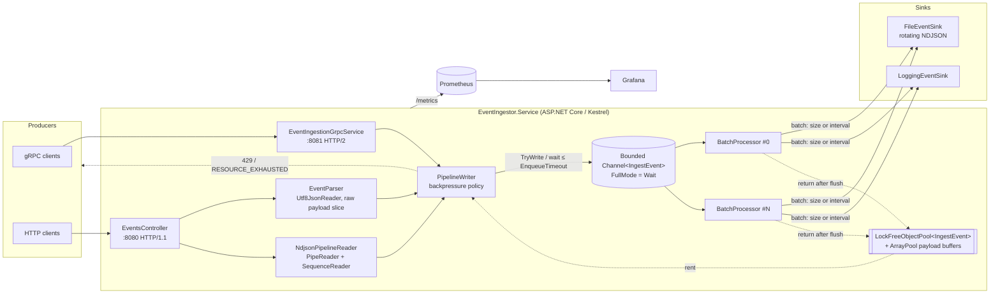
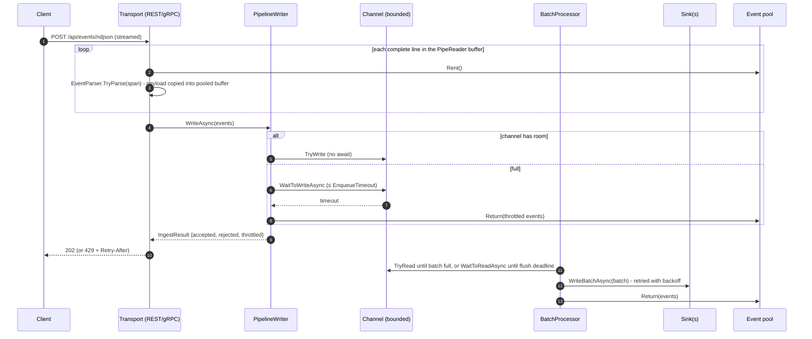

# EventIngestor

[](https://github.com/blayner/EventIngestor/actions/workflows/ci.yml)


EventIngestor is a high-throughput event ingestion service built on **.NET 10 / C# 14**.

Producers send events over **gRPC** or **HTTP** (single JSON, JSON array or streaming NDJSON). Events
go through a **bounded in-memory pipeline** and are flushed in **batches** to pluggable sinks. The
service is designed around three constraints:

1. **Low allocation on the hot path.** Payloads stay as raw UTF-8 bytes from the socket to the sink.
   Events, payload buffers and strings are pooled or interned.
2. **Bounded memory under overload.** When consumers fall behind, producers get an explicit `429` /
   `RESOURCE_EXHAUSTED`. The heap does not grow and events are not silently dropped.
3. **Observable.** Every stage exports Prometheus metrics, and the repo ships a Grafana dashboard,
   BenchmarkDotNet suites and k6 scenarios, so performance claims can be checked rather than assumed.

---

## Contents

- [Architecture](#architecture)
- [API](#api)
- [Running locally](#running-locally)
- [Configuration](#configuration)
- [Observability](#observability)
- [Benchmarks](#benchmarks)
- [Load tests](#load-tests)
- [Design decisions (ADRs)](#design-decisions-adrs)
- [.NET 10: things worth measuring](#net-10-things-worth-measuring)
- [Limitations and next steps](#limitations-and-next-steps)
- [Project layout](#project-layout)

---

## Architecture



### Event lifecycle



Key properties:

- **Zero-copy parsing where possible.** NDJSON lines contained in a single pipe segment are parsed in place. Lines that straddle segments are copied once, to the stack (≤ 512 B) or to a pooled array.
- **One batch per consumer, reused.** A `BatchProcessor` fills, flushes and clears the same `EventBatch`. Steady state allocates nothing per event.
- **Flush on size *or* time.** The time limit applies to the oldest event in the batch. The deadline token is created once per batch, not once per wait.
- **Shutdown drains.** The pipeline is completed first, so new writes get "shutting down". Processors then flush what is buffered within `DrainTimeout`.

---

## API

### Wire format

```json
{
  "id": "0197a3c2-5b1e-7c4d-9a8b-1c2d3e4f5a6b",
  "timestamp": "2026-07-20T12:00:00Z",
  "source": "checkout-api",
  "type": "order.created",
  "payload": { "orderId": 42, "total": 199.90 }
}
```

| Field | Required | Notes |
|---|---|---|
| `source`, `type` | yes | 1–128 UTF-8 bytes |
| `id` | no | UUID; generated server-side as a time-ordered UUIDv7 when absent |
| `timestamp` | no | ISO-8601 string or Unix milliseconds; defaults to receive time |
| `payload` | no | Any JSON value, stored verbatim (whitespace included), ≤ `MaxPayloadBytes` |

Unknown properties are ignored.

### HTTP (port 8080)

| Method & path | Body | Notes |
|---|---|---|
| `POST /api/events` | one event | `400` with problem details when invalid |
| `POST /api/events/batch` | JSON array of events | invalid elements are counted and skipped; malformed array → `400` |
| `POST /api/events/ndjson` | newline-delimited events | streamed; no body size limit (memory bounded by `MaxLineBytes`) |
| `GET /health/live` | | process is up |
| `GET /health/ready` | | JSON report; `Unhealthy` if no consumer runs, `Degraded` at ≥ 90 % queue usage |
| `GET /metrics` | | Prometheus exposition |
| `GET /openapi/v1.json` | | OpenAPI document (Development environment) |

Responses carry per-event counts:

```json
{ "accepted": 98, "rejected": 1, "throttled": 1, "total": 100 }
```

- `202 Accepted`: nothing throttled. `rejected` counts invalid events, which should not be retried.
- `429 Too Many Requests` with `Retry-After`: some events were throttled. Retry only the throttled ones, with backoff.

"Accepted" means the event is in the in-memory pipeline, not that a sink has it yet (see [ADR-006](#adr-006-at-least-once-delivery-to-sinks-in-memory-buffer)).

### gRPC (port 8081, HTTP/2 cleartext)

See [`ingest.proto`](src/EventIngestor.Service/Protos/ingest.proto): `Ingest` (unary), `IngestBatch`
(unary, per-event counts) and `IngestStream` (client streaming). `payload` is the UTF-8 JSON value as
bytes and is validated on arrival.

---

## Running locally

Prerequisites: .NET 10 SDK. Optional: Docker, k6, grpcurl.

```bash
# Service only (Development: logging sink on, OpenAPI exposed)
dotnet run --project src/EventIngestor.Service

# Full stack: service + Prometheus (:9090) + Grafana (:3000, dashboard "EventIngestor")
docker compose up -d --build
```

```bash
# Single event
curl -i localhost:8080/api/events -H 'Content-Type: application/json' \
  -d '{"source":"cli","type":"test.ping","payload":{"ok":true}}'

# NDJSON stream
printf '%s\n' '{"source":"cli","type":"a"}' '{"source":"cli","type":"b"}' |
  curl -s localhost:8080/api/events/ndjson -H 'Content-Type: application/x-ndjson' --data-binary @-

# gRPC (payload is base64 of {"ok":true})
grpcurl -plaintext -import-path src/EventIngestor.Service/Protos -proto ingest.proto \
  -d '{"source":"cli","type":"test.ping","payload":"eyJvayI6dHJ1ZX0="}' \
  localhost:8081 eventingestor.v1.EventIngestion/Ingest
```

```bash
dotnet test     # unit + integration tests (xUnit v3, WebApplicationFactory)
```

---

## Configuration

All settings live under `Ingestor` in `appsettings.json`. They can be overridden with environment variables such as `Ingestor__Pipeline__BatchSize=2000`.

| Setting | Default | Meaning |
|---|---|---|
| `Pipeline:ChannelCapacity` | 100 000 | Events buffered before backpressure kicks in. This is the memory budget. |
| `Pipeline:BatchSize` | 1 000 | Max events per flush |
| `Pipeline:FlushInterval` | 250 ms | Max time the oldest event waits in a partial batch |
| `Pipeline:ConsumerCount` | cores / 2 | Concurrent batch processors |
| `Pipeline:EnqueueTimeout` | 50 ms | How long a producer waits for room before being throttled (`0` = fail fast) |
| `Pipeline:MaxFlushRetries` / `RetryBaseDelay` | 3 / 100 ms | Per-sink retries; exponential backoff with jitter, capped at 5 s |
| `Pipeline:DrainTimeout` | 10 s | Budget to flush buffered events on shutdown |
| `Pipeline:MaxPayloadBytes` | 256 KiB | Per-event payload limit |
| `Pipeline:MaxLineBytes` | 512 KiB | Per-line NDJSON limit (longer lines are skipped, not fatal) |
| `Pipeline:MaxRequestBytes` | 16 MiB | Body limit for buffered endpoints (single, batch) |
| `Pipeline:EventPoolSize` | 16 384 | Idle pooled events kept for reuse |
| `Sinks:File:Enabled` / `OutputDirectory` / `MaxFileBytes` / `FlushToDisk` | true / `data/events` / 256 MiB / false | NDJSON file sink |
| `Sinks:Logging:Enabled` | false (true in Development) | Logs one line per batch |

---

## Observability

| Metric | Type | Labels |
|---|---|---|
| `ingestor_events_accepted_total` | counter | `transport` (grpc, http, ndjson) |
| `ingestor_events_rejected_total` | counter | `transport`, `reason` (invalid_event, payload_too_large, backpressure, shutting_down) |
| `ingestor_http_request_duration_seconds` | histogram | `method`, `endpoint` (route template / gRPC method), `status` |
| `ingestor_http_requests_in_flight` | gauge | |
| `ingestor_pipeline_queue_depth` / `_capacity` | gauge | |
| `ingestor_batch_size_events` | histogram | `sink` |
| `ingestor_batch_flush_duration_seconds` | histogram | `sink` |
| `ingestor_batch_failures_total` / `ingestor_events_dropped_total` | counter | `sink` |
| `ingestor_event_pool_retained` / `_created_total` / `_dropped_total` | gauge / counter | |

prometheus-net also exports process and GC metrics. The provisioned Grafana dashboard
([`grafana/dashboards/eventingestor.json`](grafana/dashboards/eventingestor.json)) has panels for
ingestion, the pipeline (queue, batch size, flush latency, sink failures) and runtime (pool, memory, GC, CPU).

---

## Benchmarks

The BenchmarkDotNet suites live in [`benchmarks/EventIngestor.Benchmarks`](benchmarks/EventIngestor.Benchmarks). They run on the host runtime (.NET 10), and every suite uses `[MemoryDiagnoser]`.

```bash
# Everything (takes a while)
dotnet run -c Release --project benchmarks/EventIngestor.Benchmarks -- --filter '*'

# One suite, shorter job
dotnet run -c Release --project benchmarks/EventIngestor.Benchmarks -- --filter '*ParserBenchmarks*' --job short

# Export markdown/CSV (written to BenchmarkDotNet.Artifacts/results)
dotnet run -c Release --project benchmarks/EventIngestor.Benchmarks -- --filter '*' --exporters github csv
```

| Suite | Compares |
|---|---|
| `SerializationBenchmarks` | `JsonSerializer` reflection vs source-generated (payload as `JsonElement`) vs `EventParser` raw slice, with and without the string cache. Also serialization with `JsonSerializer` vs `EventSerializer` raw payload. |
| `ParserBenchmarks` | NDJSON body to events in the channel: `StreamReader.ReadLine` + UTF-16 + re-encode vs `NdjsonPipelineReader` |
| `PoolingBenchmarks` | New object + copied array + decoded strings vs pooled event + ArrayPool buffer + interned strings |
| `PipelineBenchmarks` | Per-event cost of channel + batching with 1/4 consumers and batch size 100/1000 (null sink) |

### Design targets

These are **targets** the design aims for and that the load tests use as thresholds. They are **not measured results**.

| Target | Value |
|---|---|
| Sustained ingest (single node, 4 cores) | 50 000 events/s |
| HTTP single-event latency at the load test rate | p99 < 25 ms |
| Steady-state allocations on the pipeline path | ~0 B/event after warm-up |
| Memory under 2× overload | flat (bounded by `ChannelCapacity`), excess answered with 429 |

### Results

*Run locally to reproduce.* Numbers depend heavily on hardware, so this table is left for whoever
runs the suites to fill in with their own machine's output (include CPU, OS and .NET build).

| Benchmark | Params | Mean | Allocated | Machine |
|---|---|---|---|---|
| | | | | |

CI runs every benchmark once with `--job Dry`. That only proves the suites build and execute. Shared
runners are too noisy for their numbers to mean anything, so CI publishes no figures.

---

## Load tests

The k6 scenarios are in [`load-tests/`](load-tests/README.md). There is a smoke test (it runs in CI against the Docker image), a sustained load test at the design target, a stress ramp to saturation, a spike, and a gRPC variant. Their thresholds are the targets above. Watch the Grafana dashboard while they run: queue depth and backpressure rejections tell you more than the client-side summary does.

---

## Design decisions (ADRs)

### ADR-001: System.IO.Pipelines for streaming bodies

**Context.** NDJSON bodies can be arbitrarily large and arrive in arbitrary chunks. `StreamReader.ReadLine` decodes every byte to UTF-16, allocates a string per line, and needs re-encoding before UTF-8 JSON parsing.

**Decision.** Read `HttpRequest.BodyReader` (a `PipeReader`) and find newlines with `SequenceReader<byte>`. Parse lines in place with `Utf8JsonReader`. Leave incomplete trailing lines unconsumed (`AdvanceTo(consumed, examined)`) so the pipe manages buffering.

**Consequences.** Request memory is bounded by `MaxLineBytes`, whatever the body size. Most lines are never copied. The cost is complexity: `SequenceReader` is a ref struct, so parsing lives in synchronous helpers called from the async loop, and multi-segment lines need explicit handling. `ParserBenchmarks` measures the trade-off against the naive approach.

### ADR-002: `Channel<T>` over `BlockingCollection<T>`

**Context.** Producers are async request handlers and consumers are long-running loops. Both need backpressure.

**Decision.** Use a bounded `System.Threading.Channels` channel with `FullMode = Wait`, `SingleWriter = false`, `SingleReader` only when there is one consumer, and `AllowSynchronousContinuations = false`.

**Consequences.** Waiting is async on both sides: no thread is blocked per waiting producer, unlike `BlockingCollection.Add`. `TryWrite` gives a non-blocking fast path and a clear "full" signal. Async continuations keep consumer work off request threads. Drop modes were rejected because they lose data silently, and with pooled events they would also leak pool instances.

### ADR-003: gRPC and REST side by side

**Context.** Internal services want an efficient typed contract. Edge clients, scripts and browsers want plain HTTP and JSON.

**Decision.** Serve both from one Kestrel host on separate endpoints: `:8081` HTTP/2 for gRPC (cleartext needs prior knowledge, so it gets its own port) and `:8080` HTTP/1.1 for REST, health and metrics. Both transports funnel into the same `PipelineWriter`, so validation, backpressure and metrics are identical.

**Consequences.** One deployment and one pipeline. gRPC adds `IngestStream` for long-lived producers. The REST NDJSON endpoint covers bulk loads without a client library.

### ADR-004: Backpressure is explicit, never silent

**Decision.** When the channel is full, a producer waits at most `EnqueueTimeout`. After that the event is throttled and reported (`429` + `Retry-After`, `RESOURCE_EXHAUSTED`, or a `throttled` count). Within a batch, once one event times out the rest get only a non-blocking attempt, so an overloaded request pays at most one timeout. Readiness turns `Degraded` at 90 % usage.

**Consequences.** Overload costs latency (bounded) and retries, but not memory or lost data. Clients must implement retry with backoff.

### ADR-005: Raw payload bytes, pooled events, interned names

**Decision.** The payload is kept as raw UTF-8 and written out with `WriteRawValue`. `IngestEvent` instances come from a lock-free pool, and their payload buffer is an `ArrayPool` array kept across reuses while it stays ≤ 4 KiB. `source`/`type` are interned through a lock-free direct-mapped UTF-8 → string cache.

**Consequences.** Steady state should allocate close to nothing per event. `PoolingBenchmarks` and the `ingestor_event_pool_created_total` metric verify this. In exchange, events have an ownership protocol: whoever holds an event either passes it on or returns it, and sinks must not retain events after `WriteBatchAsync` returns. That contract is documented on `IEventSink`, and `PipelineWriter` owns cleanup on cancellation.

### ADR-006: At-least-once delivery to sinks, in-memory buffer

**Decision.** Sink writes are retried with exponential backoff and jitter. A batch interrupted by shutdown is flushed again during the drain. After `MaxFlushRetries` the batch is dropped for that sink and counted (`ingestor_events_dropped_total`). The buffer is in memory only.

**Consequences.** Sinks can see duplicates, so downstream consumers should dedupe on `id`. A process crash loses whatever is in the channel, up to `ChannelCapacity` events. A durable variant would need a write-ahead log or an upstream broker (see below).

---

## .NET 10: things worth measuring

This project targets .NET 10 (LTS). Several runtime features plausibly affect this workload. They are listed as **hypotheses to measure** with the benchmarks and load tests, not as results:

- **DATAS (dynamic GC heap sizing)** is the Server GC default since .NET 9. Compare steady-state working set and GC counts under `load.js` with `DOTNET_GCDynamicAdaptationMode=0` and `=1`.
- **JIT improvements in .NET 10** (escape analysis / stack allocation of small objects, more devirtualization, loop optimizations). Re-run `PipelineBenchmarks` and `ParserBenchmarks` across runtimes, e.g. by adding a .NET 9 job (`--runtimes net9.0 net10.0`), and compare.
- **Dynamic PGO** (on by default). Compare warm-up curves in Grafana with `DOTNET_TieredPGO=0` vs the default.
- **System.Text.Json updates.** `SerializationBenchmarks` shows whether the gap between the source-generated serializer and the hand-written `Utf8JsonReader` parser narrows on newer runtimes.

---

## Limitations and next steps

- **No durability.** In-flight events are lost on crash (ADR-006). Next step: a Kafka/NATS sink, plus an optional local write-ahead log.
- **No authentication or multi-tenancy.** Planned: API keys per source with per-key rate limits (ASP.NET Core rate limiting).
- **Single node.** Horizontal scaling works behind a load balancer, since nodes share nothing, but there is no ordering guarantee across nodes.
- **gRPC status in metrics.** Request metrics record the HTTP status. The gRPC status code is in trailers and is not yet labelled.
- **Benchmark results.** Intentionally not published. See [Results](#results).

---

## Project layout

```
src/
  EventIngestor.Core/        models, wire-format parser/serializer, pooling, abstractions
  EventIngestor.Pipeline/    channel pipeline, PipelineWriter, BatchProcessor, NDJSON reader, sinks
  EventIngestor.Service/     ASP.NET Core host: gRPC service, REST controller, metrics, health
tests/
  EventIngestor.Tests/       unit tests + API integration tests (xUnit v3)
benchmarks/
  EventIngestor.Benchmarks/  BenchmarkDotNet suites
load-tests/k6/               smoke, load, stress, spike, gRPC scenarios
grafana/                     provisioning + dashboard
docker-compose.yml           service + Prometheus + Grafana
```

## License

[MIT](LICENSE)
